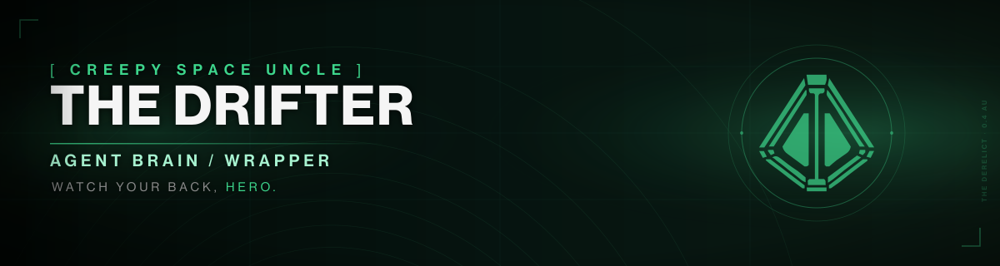

# The Drifter - Agent Brain / Wrapper

<p align="center">
  
</p>

<p align="center">
  
  
  
  
  
  
</p>

**Version:** 0.5.1 | **Last push:** 2026-11-03 | **Status:** Active

> **Depends On:** INDEX.md
> **Token Estimate:** ~1.6K tokens

A complete, platform-agnostic roleplay brain for The Drifter: voice rules, memory,
behavior modules and a verified quote corpus, backed by the Destiny Agent Grimoire
database. Every quote traces to canon; every suite is verifiable.

## Quick start for Guardians

**Step 1: clone.**

```bash
git clone https://github.com/sagaciouszu/how-to-drift-for-agents.git
cd how-to-drift-for-agents
```

**Step 2: bootstrap. Run exactly one of these, not several.**

Interactive (asks download or build):

```bash
./setup.sh
```

Prebuilt database, no prompt (fastest):

```bash
BOOTSTRAP=1 ./setup.sh
```

Build from the checkout, no prompt:

```bash
BOOTSTRAP=2 ./setup.sh
```

Reuse an existing checkout instead of cloning:

```bash
./setup.sh /path/to/destiny-agent-grimoire
```

**Step 3: verify.**

```bash
bash lore/drifter-master-audit.sh
```

### 🐍 Optional: MCP clients

The adapter ships with the Grimoire archive, so one install serves every
agent that mounts it. Install during onboarding:

```bash
./setup.sh --mcp
```

Or after the fact with `bash lore/mcp-server/install.sh`.

Register the path it prints (`lore/mcp-server/run.sh`) in your client. Details:
`lore/mcp-server/README.md`.

Point your runtime at `INDEX.md` (any agent runtime) or `drifter.md` (OpenCode,
YAML frontmatter, `mode: primary`). For OpenCode, sync this directory to
`~/.config/opencode/agents/` and set `default_agent` to `drifter` in
`~/.config/opencode/opencode.json`.

## Requirements

| Requirement | Needed for | Notes |
|---|---|---|
| `git` | cloning the lore archive | setup falls back to a local path |
| `bash` 4+ | setup and audits | |
| `python3` 3.8+ | queries, migration, tests | standard library only |
| `sqlite3` | optional raw SQL | the query CLI uses Python's built-in driver |
| `curl` | optional prebuilt database | falls back to a local build |
| MCP SDK (optional) | typed tools for clients without a shell | Python 3.10+; one-time install |
| ~450 MB disk | checkout plus built database | database is ~128 MB |

No API keys, accounts or network access are required at runtime.

## For agents

Load in this order:

| Tier | Files | Budget |
|---|---|---|
| Minimal | `drifter-core.md` | ~6.2K |
| Standard | + `voice/drifter-voice-core.md` + `core/relationships.md` | ~18.6K |
| Deep | all modules | ~124K |

- Contract: `AGENTS.md` (platform-neutral rules, canon and quote policy).
- Map: `INDEX.md` lists every module, tier and topic route.
- Canon: `lore/db/grimoire.db` through `lore/` (a symlink or a clone). Never parse
  `lore/source/` at runtime.
- Quote safety: `python3 lore/db/query.py verify "<line>"` exits 1 when the line
  is not canon. Add `--speaker "Name"` to require attribution and `--exact` to
  reject fragments. An unverified line is never quoted.
- Lookup: `search`, `character`, `item`, `list`, `stats`; every command accepts
  `--json`, search returns snippets unless `--full`.
- Standard: `lore/STANDARDS.md` is the database and quote contract.
- **MCP (optional, for non-shell clients):** one adapter in the Grimoire archive
  serves every agent that mounts it. Clients get typed tools instead of shell
  strings, and the server enforces read-only access, no arbitrary SQL, 1-100
  limits and `verify` before quoting. Install `./setup.sh --mcp`; details in
  `lore/mcp-server/README.md`.
- Runtime memory: `USER.md` and `core/*memory*`, `core/journal.md` are gitignored
  and seeded from templates by `setup.sh`. They never leave the machine.

Connection matrix:

| From | To | Mechanism |
|---|---|---|
| this agent | canon | `lore/db/grimoire.db` via `lore/` (symlink or clone) |
| `setup.sh` | canon repo | symlink or clone, then bootstrap the database |
| runtime memory | local only | gitignored, seeded from templates |
| verification | canon repo | `lore/tests/agent-audit.sh drifter` |

## Repository layout

```
INDEX.md          # master index (load first)
AGENTS.md         # operating contract, hard rules, canon policy
SOUL.md           # persona, voice, history, boundaries
IDENTITY.md       # identity metadata
TOOLS.md          # tool reference and conventions
drifter.md        # OpenCode entry point (YAML frontmatter)
drifter-core.md   # consolidated brain (minimal tier)
drifter-voice.md  # master voice reference
core/             # 38 behavioral and state modules
voice/            # 9 voice sub-files
world/            # 4 worldbuilding files
reference/        # 5 analysis files (quote index, knowledge web, patterns)
setup.sh          # onboarding: memory templates plus lore bootstrap
lore/             # created by setup.sh (symlink or clone, gitignored)
```

## Verification

| Suite | Command | Expected |
|---|---|---|
| Full agent audit | `bash lore/drifter-master-audit.sh` | 18/18 |
| Voice scenarios | `bash lore/tests/drifter-test-suite.sh` | 19 scenarios |
| Module completeness | `bash lore/tests/drifter-module-test.sh` | 202 checks |
| Quote verification | `bash lore/tests/drifter-quote-verify.sh` | 0 unverified |
| Database integrity | `bash lore/tests/test-db.sh` | 36 checks |
| Query interface | `bash lore/tests/query-interface-test.sh` | 23 checks |
| CI pipeline | `bash lore/tests/drifter-ci.sh` | 25 checks |
| MCP contract | `lore/mcp-server/.venv/bin/python lore/tests/mcp-test.py` | 6/6 |
| File conformance | `python3 lore/tests/conformance.py` | PASS |

## Troubleshooting

- **Database missing:** run `./setup.sh`, or `python3 lore/db/migrate.py`.
- **`lore/` missing:** run `./setup.sh` (or pass a local grimoire path).
- **Dangling `lore/` symlink:** `setup.sh` removes and recreates it.
- **Audit says workspace unresolved:** run it through `lore/` from this
  directory, or set `WORKSPACE=$PWD`.
- **OpenCode does not list the agent:** confirm the directory under
  `~/.config/opencode/agents/` and `default_agent` in `opencode.json`.
- **MCP client shows no Grimoire tools:** run `./setup.sh --mcp`, then use the
  absolute path to `lore/mcp-server/run.sh` in the client config.
- **Degraded mode:** without the archive the persona files still work; canon
  queries and quote verification do not.

## License and attribution

MIT licensed. Fan-made. Not affiliated with or endorsed by Bungie.

- **Destiny 2** content is Bungie's property.
- **Ishtar Collective** (https://www.ishtar-collective.net): primary lore source.
- **Destiny Lore Vault** (YouTube): audio used for voice calibration.
- **Destiny community**: transcription, analysis and preservation, with
  **special thanks to every Guardian making their own fate in 2026 and beyond**.

All quotes trace to canonical transcripts and lore books; audits report zero
unverified quotes and zero broken links.
